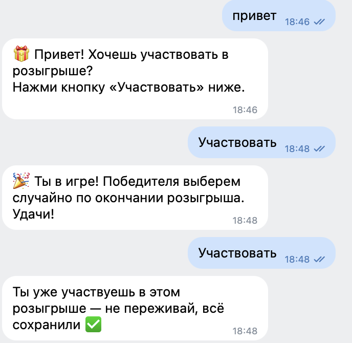
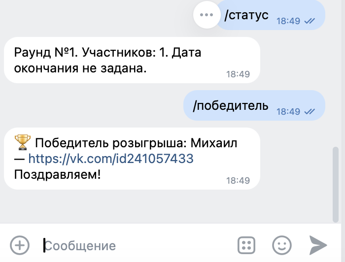

# 🎁 Бот-розыгрыш ВКонтакте (giveaway bot)

Бот для проведения розыгрышей в сообществе ВКонтакте. Работает в личных сообщениях группы.

**Что умеет:**
- Кнопка «Участвовать» — одно нажатие, и человек в розыгрыше
- Проверяет подписку на заданные сообщества (можно несколько — для совместных giveaway)
- Защита от накруток: 1 человек = 1 участие, повторно зарегистрироваться нельзя
- Выбирает случайного победителя и даёт ссылку на его профиль
- Устанавливает дату окончания розыгрыша
- Сброс розыгрыша в один клик — сразу можно запускать новый
- Все участники хранятся в базе данных, ничего не теряется
- Стабильно работает 24/7 и сам переподключается при сбоях

## Скриншоты

Участие по кнопке и защита от повторов:



Админ-команды: статус и выбор победителя:



---

## Как запустить (для не-программиста)

### Шаг 1. Получи токен сообщества ВК
1. Открой свою группу → **Управление** → **Работа с API** → **Ключи доступа**.
2. Нажми **Создать ключ**, отметь галочки: «Разрешить приложению доступ к сообщениям сообщества», «... к управлению сообществом».
3. Скопируй длинный ключ — он понадобится в шаге 4.

Включи там же: **Управление → Сообщения сообщества → Включены**, и в «Настройках для ботов» включи **возможности ботов**.

### Шаг 2. Узнай ID сообщества и свой ID
- ID группы: открой адрес группы, например `vk.com/club12345` — число **12345**.
- Свой ID: открой `vk.com/settings` → «Адрес страницы», или твой профиль вида `vk.com/id12345` — число **12345**.

### Шаг 3. Создай файл с ключами
1. В папке бота скопируй файл `.env.example` и переименуй копию в `.env`.
2. Открой `.env` любым текстовым редактором (Текстовый редактор на Mac, Блокнот на Windows) и заполни:
   - `VK_API_TOKEN=` — ключ из шага 1
   - `VK_GROUP_ID=` — число из шага 2
   - `ADMIN_IDS=` — твоё число из шага 2
3. Сохрани. Файл `.env` никому не показывай и не выкладывай в интернет.

### Шаг 4. Запусти бота
Открой Терминал (на Mac) и выполни по очереди:

```
cd путь/к/papke/vk-giveaway-bot
pip3 install -r requirements.txt
python3 vk_longpoll.py
```

Появится строка «Бот запущен и слушает сообщения» — открой группу, напиши боту сообщение: придёт приветствие с кнопкой «Участвовать».

### Как пользоваться (команды админа)
Пиши боту в личку сообщества текстом:

| Команда | Что делает |
|---|---|
| `/добавить имя_сообщества` | добавить обязательное сообщество (короткое имя из адреса vk.com/имя) |
| `/удалить имя_сообщества` | убрать его из списка |
| `/сообщества` | показать список обязательных |
| `/конец 2026-12-31` | задать дату окончания |
| `/статус` | сколько участников и до какого числа розыгрыш |
| `/сброс` | обнулить список и начать новый раунд |
| `/победитель` | выбрать случайного победителя (ссылка на профиль) |
| `/помощь` | список команд |

Работает только у админов из `ADMIN_IDS` — участники видят приветствие и кнопку.

---

## Проверка без ВК (для разработчика)

```
python3 test_local.py
```

Проверяет базу данных и команды без интернета: участие, защита от повторов, подписки, победитель, сброс.

## Структура файлов

| Файл | Что делает |
|---|---|
| `vk_longpoll.py` | запуск: слушает сообщения и запускает обработку |
| `bot.py` | логика: участие, проверки, админ-команды |
| `giveaway_db.py` | база данных (SQLite, файл `giveaway.db`) |
| `vk_api_client.py` | связь с API ВКонтакте |
| `config.py` | чтение ключей из `.env` |
| `test_local.py` | локальные тесты |

## Хостинг 24/7
Для круглосуточной работы бот запускают на сервере (например, VPS за ~200–300 ₽/мес) теми же командами, что в шаге 4. Бот сам восстанавливается после сбоев связи. Подробная инструкция развёртывания — по запросу.